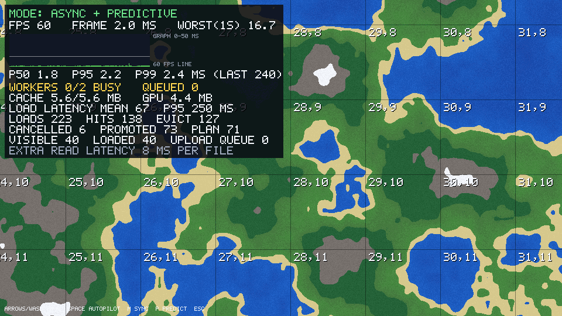
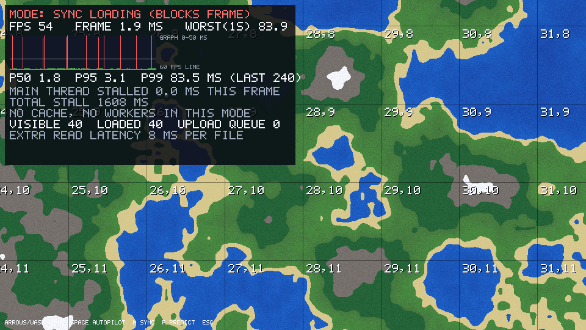

# Multithreaded Asset Streaming System

[](https://github.com/KelvinMah/game-asset-streamer/actions/workflows/ci.yml)

A C++17 asset streaming library plus a demo that flies over a 4096x2560 px world of 640 **real PNG tiles**. Files are read and decoded on worker threads (with a PNG decoder written from scratch), cached in a byte-budgeted LRU, and uploaded to the GPU on the render thread as they arrive. A live overlay shows that the main thread stays responsive.

| Async + predictive streaming | Naive synchronous loading (press **M**) |
|---|---|
|  |  |

Both frames were captured headless (SDL dummy driver, software renderer, 2 vCPUs, 8 ms of extra simulated read latency per file) after the same 420-frame scripted tour; the overlay's frame time is the main thread's work per frame. In the right-hand frame-time graph, each red spike is the main thread blocking on a file read. For measured frame-time percentiles see **Frame-time benchmark** below; the demo is for looking, the benchmark is for numbers.

## Controls (demo)

Arrows/WASD move, **Space** autopilot, **M** SYNC blocking vs ASYNC streaming, **P** predictive prefetch on/off, **Esc** quit. Options: `--latency-ms N` (extra per-read delay, default 8, models slow storage), `--threads N`, `--assets DIR`, `--autopan`, `--sync`, `--reactive`, `--screenshot FILE.bmp --frames N` (headless capture). Tiles are generated into `demo_assets/` on first run (~43 MB).

The overlay shows FPS, frame time with P50/P95/P99 over the last 240 frames, a frame-time graph with the 60 FPS line, busy workers, queue depth, CPU cache and GPU memory, load latency (mean/p95), loads, hits, evictions, cancellations and priority promotions.

## Design

| Piece | File | What it does |
|---|---|---|
| Thread pool | `ThreadPool.hpp` | Fixed workers over a priority queue. Higher priority runs first, equal priority is FIFO. `shutdown()` drains queued work; exceptions travel through the returned `SharedFuture`. |
| LRU cache | `LruCache.hpp` | Thread-safe, byte-budgeted (`list` + `unordered_map`). Values are `shared_ptr<const T>`, so evicting an asset a caller still holds never frees memory in use. |
| Asset manager | `AssetManager.hpp/.cpp` | `request(path, priority)` returns a `SharedFuture` immediately. Concurrent requests for a path trigger **one** load (coalescing). A later higher-priority request **promotes** a queued load, and `cancel(path)` removes a load that has not started (exactly one of completion, failure or cancellation happens per load). Failures reach every waiter and are not cached. `pumpCompletions()` runs callbacks on the calling (render) thread, never on a worker. `stats()` reports workers busy, queue depth, worker busy-time, cache bytes, cancellations and load latency. |
| Tile world | `TileWorld.hpp/.cpp` | The world and the logic that drives the manager: `planTiles` projects the viewport along the camera velocity and assigns priority bands (visible > predicted by arrival time > margin ring), capped at a tile budget; `TileStreamer` turns successive plans into requests, **promotions** and **cancellations**; `UploadQueue` enforces the GPU upload budget and residency policy. The demo and the benchmark share this code. |
| PNG decoder | `Png.hpp/.cpp` | Own inflate (stored/fixed/dynamic Huffman), CRC-32 and Adler-32 verification, all five row filters, gray/gray+alpha/RGB/RGBA/palette, 8-bit, non-interlaced. Bounds-checked against malformed input; caps image size against decompression bombs. |
| Sources | `AssetSource.hpp/.cpp` | `FileSource` (rejects absolute paths and `..`), `LatencySource` (adds a delay to model slow storage), `SyntheticSource` (deterministic bytes, used by tests). |

How it stays correct under concurrency: `inflight_` is guarded by one mutex. A finished load stores into the cache *before* leaving `inflight_`, so a request that finds nothing in flight either hits the cache or starts a fresh load, never a duplicate. Promotion queues a second entry at the higher priority; both share a `claimed` flag, so whichever a worker reaches first runs the load and the other is a no-op. The pool is the last member of `AssetManager`, so workers are joined before the state they use is destroyed. The demo budgets GPU uploads (4 tiles per frame) so a burst of finished loads cannot hitch a frame.

### Predictive streaming, and a bug the benchmark caught

The planner uses the camera's smoothed velocity to project the viewport 0.8 s ahead. Tiles needed sooner get higher priority; tiles that fall out of the plan are cancelled if still queued, so a fast camera does not leave workers loading terrain it has already flown past. My first version collapsed at 3x camera speed: pop-in rose to **86%** and loads and cache hits exploded. Two interacting flaws, found by the frame benchmark rather than by tests: the plan was larger than the 90-tile cache, so predicted tiles evicted each other and the visible ones; and predicted tiles beyond the keep range were uploaded and immediately evicted, then re-requested every frame, starving the per-frame upload budget. Fixes: a plan size cap below the cache capacity (`PlanSettings::maxTiles`), upload-range inside keep-range hysteresis (`UploadQueue`), and no re-requests of recently delivered prefetch tiles. Each has a regression test.

Known limitations: cancellation only removes loads that have not started (a running read finishes); there is one CPU cache and one residency policy (no separate CPU/GPU budgets, mipmaps or resolution tiers); the cache uses a single mutex (sharding is the next step under heavy contention); the PNG decoder lacks 16-bit, interlaced and `tRNS` support; assets are loose PNG files rather than a packed archive; files are read whole rather than streamed in chunks.

## Build and run

```
cmake -S . -B build
cmake --build build --parallel
ctest --test-dir build --output-on-failure
./build/frame_benchmark          # frame-time percentiles: sync vs reactive vs predictive
./build/stream_benchmark         # load-throughput comparison on real PNG files
./build/asset_demo
```

Windows with vcpkg: `cmake -S . -B build -DCMAKE_TOOLCHAIN_FILE=%VCPKG_ROOT%/scripts/buildsystems/vcpkg.cmake`, then `cmake --build build --config Release`. Pass `-DSTREAMER_BUILD_DEMO=OFF` to skip SDL2. Sanitizers (GCC/Clang): `-DSTREAMER_SANITIZER=address` or `thread`.

## Benchmark

### Frame-time benchmark (`frame_benchmark`)

`frame_benchmark [--seconds N --latency-ms N --render-ms N --threads N --cache-tiles N --assets DIR --modes LIST --speed X]`

A paced 60 Hz loop flies the same scripted camera tour over the 640-tile world in each mode, with real file reads and PNG decodes, +8 ms simulated read latency per file, 4 ms of simulated render cost, 2 workers and a 90-tile cache. "Frame work" is main-thread time per frame excluding the pacing sleep; the budget for 60 FPS is 16.7 ms. Pop-in counts tile-frames where a visible tile was not yet resident.

Sandbox results (2 vCPUs, 20 s per mode, single run):

| speed | mode | P50 | P95 | P99 | max | frames > 16.7 ms | pop-in |
|---|---|---|---|---|---|---|---|
| x1 | sync (blocking loads) | 4.0 ms | 49.3 ms | 85.5 ms | 373 ms | 5.5% | 0% |
| x1 | async, reactive | 4.0 ms | 4.1 ms | 4.4 ms | 5.9 ms | 0% | 2.07% |
| x1 | async, predictive | 4.0 ms | 4.1 ms | 4.3 ms | 5.3 ms | 0% | 0.86% |
| x3 | sync (blocking loads) | 4.0 ms | 77.0 ms | 86.5 ms | 368 ms | 15.8% | 0% |
| x3 | async, reactive | 4.0 ms | 4.1 ms | 4.9 ms | 13.1 ms | 0% | 5.07% |
| x3 | async, predictive | 4.1 ms | 4.2 ms | 4.5 ms | 6.1 ms | 0% | 1.83% |

What this shows: async streaming removes the main-thread stalls (sync pays its cost as frame spikes, async pays it as brief pop-in), and predictive prefetch cuts pop-in by 2.4x (x1) and 2.8x (x3) versus reactive loading. Sync has no pop-in only because it blocks until tiles exist.

**Caveats:** the read latency is simulated, not a real disk; files sit in the OS file cache; this is a 2-vCPU sandbox with a single run per mode, so repeat before quoting digits; the render cost is a fixed sleep, not a GPU. Quote your own numbers from your own machine.

### Load-throughput benchmark (`stream_benchmark`)

`stream_benchmark [--assets N --requests N --side PX --threads N --latency-us LIST --cache-fraction F --zipf S --frame-size N --repeats N --seed N]`

It writes 200 real 128x128 RGBA PNG files to a temp directory, then replays a seeded Zipf-distributed request stream in "frames" of 16 (like the textures one game frame needs), awaiting each frame, and compares four configurations. Everything goes through the real read + PNG decode path.

**Caveats:** the files were just written, so they sit in the OS file cache. That removes seek time, and what is measured is syscall + PNG decode + threading. The second table adds 2 ms of simulated latency per read to model slower storage. Thread speed-up depends on your core count. Run it on your machine and use your own numbers.

Sandbox results (2 vCPUs, 2 worker threads, 3,200 requests over 200 textures, cache = 25% of the decoded working set, median of 3), mean time until all of a frame's textures are ready:

| Configuration | +0 us/read | +2000 us/read | cache hit rate |
|---|---|---|---|
| synchronous, no cache (baseline) | 14.2 ms | 49.2 ms | 0% |
| thread pool, no cache | 6.5 ms (-55%) | 20.1 ms (-59%) | 0% |
| 1 thread + LRU cache | 5.1 ms (-65%) | 16.3 ms (-67%) | 66% |
| thread pool + LRU cache | 3.1 ms (-78%) | 9.0 ms (-82%) | 66% |

Promotion: with 200 loads queued, the last-queued texture is ready after 309 ms if left at Low priority, but after 6 ms when re-requested at High.

> **Sanitizers in CI.** The ASan/UBSan and TSan jobs build everything with the sanitizer, library included. (An earlier version of `CMakeLists.txt` set the flags after creating the library target, so CMake skipped the library and TSan reported false races on `shared_ptr` hand-offs; the flags are now set before any target exists.) Results move between threads through `Promise` / `SharedFuture` in `include/streamer/Future.hpp`, a small mutex and condition-variable shared state with the semantics this project needs (set once, any number of waiters, exceptions propagate), covered by `tests/FutureTests.cpp`.

## Tests

65 GoogleTest cases, also run under AddressSanitizer/UBSan and ThreadSanitizer in CI:

- **Thread pool:** priority order and FIFO ties, exception propagation, shutdown draining, many producers.
- **LRU:** eviction order, byte budget, oversized values, replacement, eviction-while-held lifetime, concurrent budget invariant.
- **Asset manager:** non-blocking `request`, cache hits, one load for 64 concurrent requests, failure and retry, main-thread callbacks, priority promotion (a promoted load runs exactly once), live stats, `FileSource` path safety, no assets outliving the manager.
- **Cancellation and races:** a queued load is cancelled and never read; a running load cannot be cancelled; every waiter is notified exactly once; re-request after cancel starts fresh; 1,500 rounds of `cancel` racing a worker's claim (each load either completes or is cancelled, never both, never twice); 8 threads issuing 20,000 random request/cancel/pump operations over 50 paths with the invariants `callbacks == requests`, `started == completed + failed + cancelled` and no corrupt assets; shutdown with 100 pending and partly cancelled loads completes every future without deadlock.
- **Planner and streamer:** stationary vs moving camera priorities, visible always outranks predicted, plan stays in the world with no duplicates and under its tile budget, determinism; cancellation of requests that left the plan, promotion, re-request after cancel delivers exactly one tile (stale callbacks are ignored), failed tiles back off instead of being hammered, warm prefetch tiles are not re-requested each frame; a **4,000-frame erratic camera** (teleports, reversals, sprints) against real worker threads verifying every delivered tile's pixels, bounded requests and that accounting balances after settling.
- **Upload queue:** per-frame budget, range and residency filtering, upload range nested inside keep range.
- **PNG:** fixtures covering every color type and deflate block type, checked against Pillow/libpng (regenerate with `tests/data/make_fixtures.py`); encode/decode round-trips for every filter; truncation, CRC corruption, oversized and unsupported headers; every truncation and 3,000 random bit-flips of a real file under the sanitizers, proving no crashes or out-of-bounds reads.
- **Stress:** 10,000 requests from 8 threads over 200 synthetic assets, and again over 60 real PNG files, with a cache sized for a fraction of the set so eviction is constant; every returned asset's path and pixel checksum is verified.
- During development the decoder was also compared pixel-for-pixel against Pillow on 400 random images (all color types, filters and compression strategies, with split IDAT chunks).
